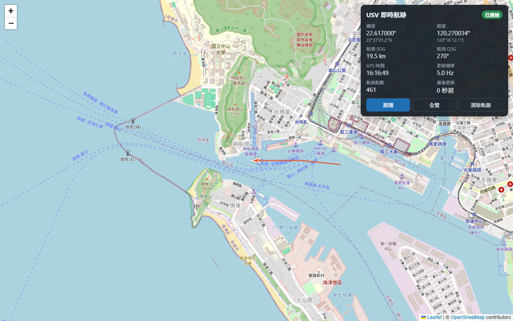
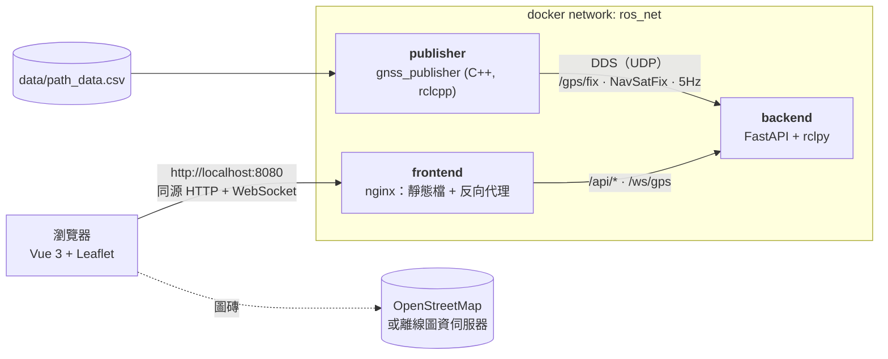

# ROS 2 + Web 即時路徑監控系統

ROS 2 節點以 5Hz 播放 GNSS 路徑（`sensor_msgs/msg/NavSatFix` → `/gps/fix`），FastAPI 橋接器把訊息轉成 JSON，透過 WebSocket 推送；Vue 3 網頁在 OpenStreetMap 上即時標出載具位置，並畫出走過的航跡。三個服務各自容器化，`docker-compose up` 一鍵啟動。

> 選做題：
> - Option RAG：[GCS 語音指令控制系統設計文件](docs/voice-command-design.md)
> - Option DevOps：[艦隊軟體 CI/CD 設計文件](docs/devops-cicd-design.md)



## 架構



| 服務 | 技術 | 職責 |
|---|---|---|
| `publisher` | ROS 2 Jazzy, C++17 | 讀取 CSV，以 5Hz 循環發佈 `NavSatFix` 到 `/gps/fix` |
| `backend` | FastAPI, rclpy | 訂閱 `/gps/fix`，轉成 JSON，保留歷史軌跡，經 WebSocket 推送 |
| `frontend` | Vue 3, Vite, TypeScript, Leaflet, nginx | 地圖、即時位置與航跡、遙測面板；nginx 同時轉發 `/api`、`/ws` |

## 快速開始

需要 Docker（Docker Desktop 或 Docker Engine + Compose v2）。

```bash
git clone https://github.com/Suyu0114/ros2-web.git && cd ros2-web
docker-compose up --build      # 或 docker compose up --build
```

第一次建置需要下載 ROS 2 image，約需數分鐘。完成後開啟 <http://localhost:8080>。

- **畫面上**：船形標記沿蘇澳港航線移動，紅線是走過的航跡。右上角面板顯示經緯度、航速、航向和更新頻率（約 5 Hz）。
- **跟隨**：地圖自動置中在船上；拖曳地圖就會停止跟隨。
- **全覽**：縮放到整條航跡。
- **重新整理頁面**：航跡還在，因為連線後後端會先送出歷史軌跡。

停止：`Ctrl+C`，或 `docker compose down`。

### 驗證

```bash
# ROS 2 端：頻率約 5Hz，欄位正確
docker compose exec publisher /entrypoint.sh ros2 topic hz /gps/fix
docker compose exec publisher /entrypoint.sh ros2 topic echo /gps/fix --once

# 後端（經過 nginx）
curl http://localhost:8080/api/healthz
curl "http://localhost:8080/api/track?limit=3"
# API 文件：http://localhost:8080/api/docs

# 端到端冒煙測試（CI 也跑這支）：snapshot 非空、fix 約 5Hz、seq 遞增
pip install websockets && python tools/smoke_test.py
```

## 專案結構

```
├── docker-compose.yml
├── data/path_data.csv            # GPS 路徑（由 tools/generate_path.py 產生）
├── publisher/                    # ROS 2 套件 gnss_publisher（C++）
│   ├── Dockerfile                # build → test（gtest）→ runtime
│   └── gnss_publisher/
│       ├── src/                  # csv_path_loader.cpp、gnss_publisher_node.cpp
│       ├── test/                 # gtest：CSV 解析
│       ├── launch/  config/
├── backend/                      # FastAPI 橋接器
│   ├── Dockerfile                # base → test（ruff + pytest）→ runtime
│   ├── app/                      # main、ros_bridge、hub、convert、schemas、settings
│   ├── tests/                    # pytest（含真的 rclpy 端到端測試）
│   └── dev/replay_csv.py         # 開發用：不需 ROS，用 CSV 餵資料
├── frontend/                     # Vue 3 + Vite + Leaflet
│   ├── Dockerfile  nginx/        # nginx 設定（反向代理、執行期 config.json）
│   └── src/                      # App、components/、composables/useGpsStream、lib/geo
├── tools/                        # generate_path.py、smoke_test.py
├── docs/                         # 選做題設計文件
└── .github/workflows/ci.yml
```

## 元件說明

### Publisher（`publisher/gnss_publisher`）

- **讀取**：`CsvPathLoader` 讀取 `latitude,longitude[,altitude]`。
  - 會略過表頭、空行、`#` 註解，也接受 CRLF 換行。
  - 格式錯誤或超出範圍的行會跳過，並記 warning（附行號）。
  - 一個有效點都沒有時，節點啟動失敗。
- **發佈**：用 wall timer 發佈。走到最後一點後回到起點，每繞完一圈記一次 log。
- **參數**（`config/params.yaml`）：

  | 參數 | 預設 | 說明 |
  |---|---|---|
  | `csv_path` | `/data/path_data.csv` | 容器內路徑 |
  | `publish_rate_hz` | `5.0` | 唯讀，範圍 0.1–100 |
  | `frame_id` | `gps` | |
  | `loop` | `true` | 走完是否從頭循環 |

- **訊息內容**：`status = STATUS_FIX / SERVICE_GPS`，`position_covariance_type = COVARIANCE_TYPE_UNKNOWN`，`header.stamp` 為發佈當下的時間。
- **QoS**：`SensorDataQoS`（best effort），感測器資料的慣例做法。訂閱端必須用相容的 QoS（見設計取捨）。

### Backend（`backend/app`）

| 端點 | 說明 |
|---|---|
| `GET /api/healthz` | `status`（`ok`／`degraded`：ROS 停用或超過 2 秒沒收到 fix）、收到的筆數、最後一筆距今秒數、連線數 |
| `GET /api/track?limit=N` | 最近的歷史軌跡（預設保留 3000 點，5Hz 下約 10 分鐘） |
| `WS /ws/gps` | 先送 `snapshot`，之後每筆 `fix` 即時推送 |

WebSocket 訊息格式：

```jsonc
// 連線後第一則：目前保存的歷史軌跡；session 在 backend 每次啟動時都不同
{"type": "snapshot", "session": "3f9c2a71d0be", "points": [ {...}, {...} ]}
// 之後每收到一筆 /gps/fix
{"type": "fix", "data": {"seq": 1024, "t": 1760870400200, "lat": 24.5939, "lon": 121.8813, "alt": 0.0, "status": 0, "frame_id": "gps"}}
```

- `seq`：橋接器收到的第幾筆有效 fix，單調遞增；前端用它去重。
- `t`：`header.stamp`，以 epoch 毫秒表示。
- `alt`：NaN 時轉成 `null`。沒有定位（`STATUS_NO_FIX`）或經緯度不是有限數值的訊息不會推送。

環境變數設定（前綴 `BRIDGE_`）：`BRIDGE_GPS_TOPIC`、`BRIDGE_HISTORY_SIZE`、`BRIDGE_CLIENT_QUEUE_SIZE`、`BRIDGE_STALE_AFTER_S`、`BRIDGE_ROS_ENABLED`。

### Frontend（`frontend/src`）

- **`useGpsStream`**：WebSocket 連到同源的 `/ws/gps`。
  - 斷線後用指數退避自動重連（1 → 2 → 4 … 最多 10 秒）。
  - 重連後依 snapshot 的 `session` 處理：
    - 同一個 backend：用 snapshot 補上斷線期間漏掉的點。
    - backend 重啟過：歷史已經清空，所以保留畫面上已有的航跡，再接上新的資料。
  - 對外提供 `status`、`track`、`latest`、`rateHz`、`lastMessageAt`。
- **`TrackMap`**：直接使用 Leaflet，不經過 wrapper。
  - 航跡只是在尾端多了幾點時，用 `addLatLng` 增量繪製；換了 snapshot、被清除或修剪過時才整條重畫。
  - 前端最多保留 5000 點，超過時一次修掉 10%，避免每一筆都整條重畫。
  - 船形標記依航向旋轉。
- **`TelemetryPanel`**：
  - 連線狀態：已連線、無資料、斷線重連中。
  - 經緯度：十進位與度分秒。
  - 航速 SOG（節）與航向 COG：用最近 5 段位移估算，平滑掉單點抖動。
  - 另外顯示 GPS 時間、更新頻率、點數、最後更新時間。
- **圖資來源可在執行期設定**：nginx 依環境變數 `TILE_URL`、`TILE_ATTRIBUTION` 產生 `/config.json`，同一個 image 可直接部署到隔離網路，改用離線圖資伺服器，不必重建。

## 路徑資料

`data/path_data.csv` 由 `tools/generate_path.py` 產生：

- **路線**：蘇澳港中央港池 → 港口 → 東南外海巡邏區 → 回港，是一個封閉迴圈。
- **航點**：在 OSM 圖磚上逐一確認，全程都在水面上。
- **避開軍港區**：北側內港是軍港，航線只使用商港水域與外海。
- **航行規則**：
  - 港口開口位於北防波堤與東防波堤之間，寬約 220 m。
  - 依航道靠右的慣例，出港走開口南半、進港走北半，兩條航道各離防波堤頭約 70 m。
  - 港外逆時針巡邏，進出港路線不交叉。
- **規模與速度**：
  - 相鄰航點之間沿大圓每 2 m 內插一點，全長 12.1 km，共 6,058 點。
  - 以 5Hz 播放約 20 分鐘繞一圈，等同約 10 m/s（約 19 節）。

```bash
python tools/generate_path.py --spacing 2.0     # 只用標準函式庫
```

換成自己的路徑：取消 `docker-compose.yml` 中 publisher 的 `volumes` 註解，指向新的 CSV。

## 設計取捨

| 議題 | 做法與理由 |
|---|---|
| ROS 2 版本 | **Jazzy**：LTS 支援到 2029，Docker image 與套件生態最完整。Lyrical 是 2026 年的 LTS，周邊套件（Nav2、MAVROS 等）還在跟上；Kilted 是短期版 |
| QoS | 兩端都用 sensor data profile（best effort）。如果 publisher 用 best effort、subscriber 用 reliable，DDS 會判定不相容，**一筆都收不到** |
| rclpy 與 asyncio | rclpy executor 在背景執行緒 spin，callback 用 `loop.call_soon_threadsafe` 把資料交回 event loop。`TelemetryHub` 只在 event loop 執行緒操作，不需要加鎖 |
| 不漏也不重複 | 新 client 的「歷史快照」與「註冊即時佇列」在同一個同步區塊完成，兩者之間不會漏也不會重複；前端另外用 `seq` 去重 |
| 慢 client | 每個 client 一個有上限的佇列，滿了就丟最舊的一筆，不拖慢其他 client，記憶體也不會無限成長 |
| 斷線偵測 | WebSocket handler 用 anyio task group 同時送與收，client 一斷線就結束，不必等到下一次送出失敗 |
| 同源反向代理 | 瀏覽器只連 nginx。前端不寫死後端位址，也沒有 CORS 問題；後端不對外開 port |
| backend 換 IP | nginx 的 `proxy_pass` 若寫死主機名稱，只會在啟動時解析一次；backend 重建後換了 IP，就會一直回 502。改用變數加上 `resolver`（Docker 內建 DNS），每 10 秒重新解析 |
| bridge 重啟 | backend 重啟後歷史清空、`seq` 從 1 重新編號。snapshot 帶有 `session`，前端據此保留畫面上已有的航跡，不會被清掉 |
| 跨容器 DDS | `FASTDDS_BUILTIN_TRANSPORTS=UDPv4`：容器之間不共用 `/dev/shm`，若啟用 SHM transport，可能 discovery 成功卻收不到資料 |
| 關閉流程 | `rclpy.init(signal_handler_options=NO)`，訊號交給 uvicorn 處理，`docker stop` 時走 lifespan 正常關閉 ROS |
| 供應鏈 | Python 依賴用 `uv` 鎖定版本並附雜湊（`pip --require-hashes`）；npm 依賴只取兩週前已發布的版本，並以 `npm ci --ignore-scripts` 安裝；CI 的 action 固定 commit SHA；backend 以非 root 使用者執行 |

## 開發（不需要 Docker）

```bash
# Backend：本機 venv（Python ≥ 3.12），不需要 ROS 的測試
cd backend
uv venv .venv && uv pip install -r requirements.txt -r requirements-dev.txt
.venv/bin/pytest            # 需要 rclpy 的測試會自動略過，在 CI 的容器內跑
python dev/replay_csv.py ../data/path_data.csv   # 不需要 ROS，用 CSV 餵資料到 :8000

# Frontend
cd frontend
npm ci --ignore-scripts
npm run dev                 # http://localhost:5173，/api、/ws 轉給 :8000
npm test && npm run typecheck
```

各元件的完整測試（在 image 內，與 CI 相同）：

```bash
docker build -f publisher/Dockerfile --target test .   # colcon build + gtest
docker build --target test backend                     # ruff + pytest（含 rclpy 端到端）
```

更新 Python 依賴：

```bash
uv pip compile requirements.in --universal --python-version 3.12 --generate-hashes -o requirements.txt
```

## 疑難排解

- **容器內出現 `/bin/bash^M` 或 `exec format error`**：shell script 被轉成了 CRLF。repo 的 `.gitattributes` 已強制使用 LF；如果是更早 clone 的，執行 `git add --renormalize .` 後重新 checkout。
- **Windows Git Bash 執行 `docker compose exec publisher /entrypoint.sh …` 出現 `C:/Program Files/Git/entrypoint.sh: no such file`**：Git Bash 會把 `/entrypoint.sh` 轉成 Windows 路徑。在指令前加上 `MSYS_NO_PATHCONV=1`，或改用 PowerShell。
- **`/api/docs` 是空白頁**：Swagger UI 的 JS／CSS 是從 CDN（jsdelivr）載入的，隔離網路下無法使用；請直接讀 `/api/openapi.json`。
- **頁面顯示「已連線・無資料」**：
  1. 用 `docker compose logs publisher` 確認節點是否正常啟動。
  2. 確認三個 ROS 服務的 `ROS_DOMAIN_ID` 和 DDS 設定一致。
- **8080 已被占用**：修改 `docker-compose.yml` 中 frontend 的 `ports`，例如 `"18080:80"`。
- **地圖沒有底圖**：瀏覽器需要能連到 `tile.openstreetmap.org`。在隔離網路中，請把 `TILE_URL` 設成離線圖資伺服器。
- **底圖變成「Access blocked / 403」**：OSM 的[圖磚使用政策](https://operations.osmfoundation.org/policies/tiles/)要求瀏覽器送出 Referer，所以 nginx 的 `Referrer-Policy` 必須維持 `strict-origin-when-cross-origin`，不能改成 `no-referrer`。
  - 曾經被擋過的話，瀏覽器可能快取了 403 圖磚，按 `Ctrl+Shift+R` 強制重新整理。
  - OSM 是志工維運的免費服務，不適合大量或正式使用；正式部署請自架圖資伺服器，或改用商用圖資。
