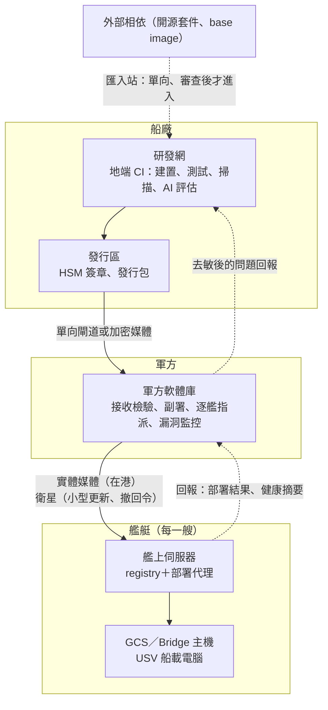
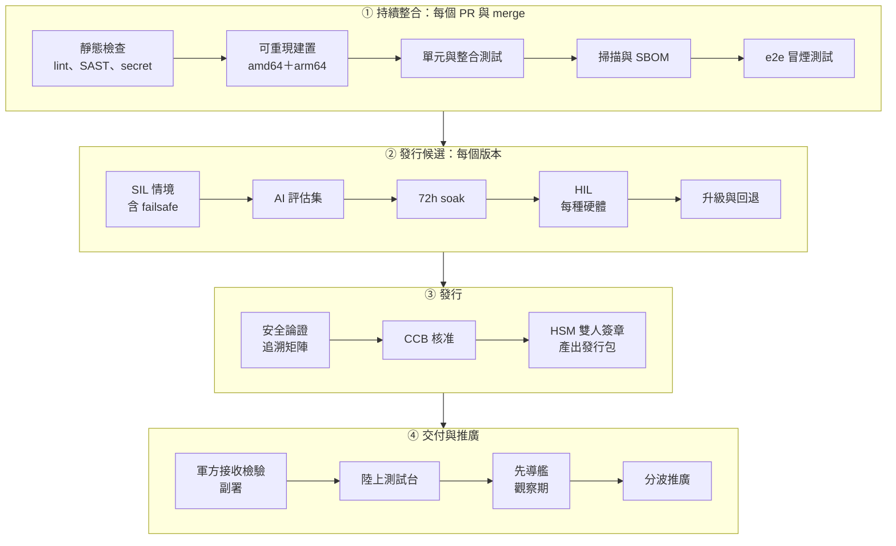
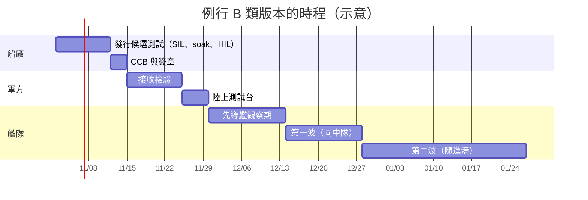
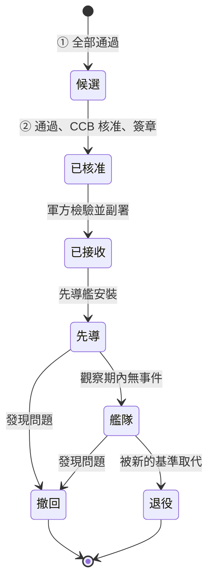
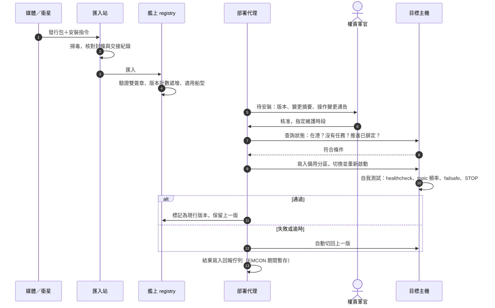
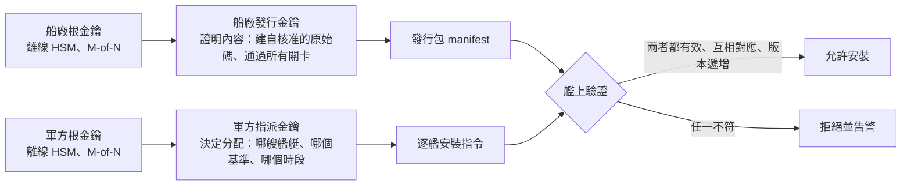
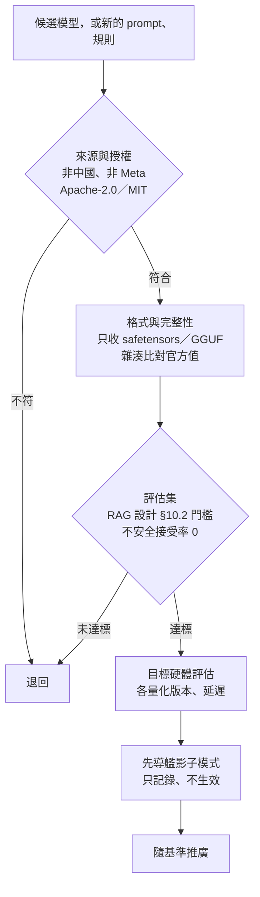

# 艦隊軟體 CI/CD 設計文件

> Option DevOps｜狀態：設計（本題不實作）｜版本 0.1｜2026-10-20
>
> 交付的軟體：本 repo 的三個服務（見 [README](../README.md)），以及[語音指令系統](voice-command-design.md)的 AI 元件。
> 情境：船廠研發團隊 → 軍方 → 艦隊。艦艇大部分時間離線，交付以實體媒體為主、衛星為輔。

## 摘要

艦艇在海上可能幾週到幾個月沒有穩定的網路，衛星頻寬也要優先給作戰通訊，所以不能照搬商用服務「merge 之後自動上線」的做法。

一個版本從 commit 到艦上，要經過四段：

1. **持續整合**（船廠研發網）：每個 PR 都要通過靜態檢查、可重現建置、單元與整合測試、相依與 image 掃描，以及 e2e 冒煙測試。
2. **發行候選**（船廠）：
   - 測試：SIL 情境（含 failsafe）、AI 評估集、72 小時 soak、HIL、升級與回退。
   - 結果彙整成安全論證，由組態管制委員會（CCB）核准，再由兩人在 HSM 上簽章。
3. **軍方接收**：軍方用自己的工具重新掃描、跑隱藏的評估集、做獨立驗證。通過後軍方副署，並決定哪艘船裝哪個版本。
4. **艦隊推廣**：順序是陸上測試台 → 先導艦 → 分波推廣。艦上的部署代理只在維護狀態下安裝，新版寫入備用分區，自我測試失敗就自動回退。

整個設計的立場是：**自動化負責產生證據，人負責決定上艦；船端不相信任何來源，只相信驗證得過的簽章。**

| 關鍵決策 | 選擇 | 理由 |
|---|---|---|
| 交付通道 | 實體媒體為主；衛星只傳 KB–MB 級的小型更新與撤回令 | 艦艇長期離線，衛星頻寬小，而且要先給作戰通訊用 |
| 成品 | 只建置一次，之後每一關都用同一個 digest（build once, promote） | 船上執行的就是測過的那一份，下游不重建 |
| 信任 | 船廠簽「內容」，軍方簽「指派」；兩個簽章都驗過才安裝（參考 Uptane） | 任何一方的金鑰外洩，都不足以把軟體裝上艦 |
| 防降版攻擊 | 版本計數只增不減；艦上自己回退到上一版可以，從外部安裝舊版要另外授權 | 防止攻擊者重放有已知漏洞、但簽章合法的舊版 |
| 船端更新 | 只在維護狀態安裝；A/B 分區、自我測試、自動回退 | 更新不能讓船在海上失去能力 |
| Safety 關卡 | 依 MIL-STD-882E 的 SwCI，決定每個元件要過哪些關卡 | 把「元件有多關鍵」轉成「要測多嚴」，而且由管線自動執行 |
| AI 成品 | 模型、prompt、Gate 規則都當成組態項；任一項變動就重跑評估，不安全接受率必須為 0 才能發行 | 接續 RAG 設計 §10.3 的 CI 回歸要求 |
| AI 輔助研發 | 地端模型只提建議，不當關卡，不自動 merge | 關卡必須是確定性的，責任仍在人 |
| CI 平台 | 船廠地端自建，與網際網路隔離；本 repo 的 GitHub Actions 是開發段的原型 | 軍規環境不能依賴雲端服務 |

---

## 1. 目標與範圍

### 1.1 目標

- 研發團隊可以頻繁整合（一天多次），但艦隊只會收到經過完整驗證、經過授權的版本。
- 艦上執行的每一個位元組，都能追溯到原始碼、建置環境、測試結果和核准人。
- 更新不會降低艦艇或 USV 的安全性；更新失敗時，能自動回到上一個可用的版本。
- 在長期離線、低頻寬的條件下也能運作。
- 艦艇服役 20 年以上，期間任何一個已部署的版本都能重建。

### 1.2 交付物

| 交付物 | 例子 | 大小 | 說明 |
|---|---|---|---|
| 應用程式容器 | 本 repo 的 publisher、backend、frontend；USV 自駕節點 | 數十到數百 MB | OCI image，支援多種 CPU 架構 |
| AI 成品 | ASR、LLM 權重（量化版）、LoRA、embedding 模型 | 數 GB | 以 OCI artifact 的形式存放 |
| AI 組態 | prompt 範本、JSON schema、Gate 規則、ITN 規則 | KB 級 | 與安全相關，和程式碼同等管制 |
| 船型設定 | 速度上限、感測器參數的預設值與 schema | KB 級 | 各艦的校正值留在艦上，不放進發行包 |
| 主機 OS | 不可變（immutable）的 OS image | 1–3 GB | 更新頻率比應用程式低 |
| 文件 | 繁中 release notes、操作變更通告、已知限制 | — | 隨版本一起發行 |

### 1.3 不在範圍

- **任務包**（航點、電子圍籬、SOP）：屬於作戰資料，由任務規劃單位產生並簽章，不走船廠管線。管線只交付任務包的 schema 與驗證工具。
- **武器系統**及其射控軟體。
- **設備商韌體**（推進、電力等）：由設備商自己的流程認證。本管線只記錄版本，並檢查相容性。
- **金鑰與憑證的發放**，例如每艘船的 SROS2 金鑰：由軍方在接收或整備時配發，不放進發行包。

### 1.4 假設

- **網路**：
  - 船廠研發網與網際網路隔離，外部相依只能經由匯入站單向進入。
  - 軍方有自己的網路與艦隊支援單位，本文稱為「軍方軟體庫」。船廠不能直接連到艦艇。
- **艦艇連線**：
  - 在港時，可以用實體媒體或碼頭的有線網路更新。
  - 在海上只有衛星：頻寬以數十 kbps 計，優先給作戰通訊；電磁管制（EMCON）期間完全不發送。
- **艦上設備**：
  - 每艘艦艇有一台艦上伺服器（registry＋部署代理），GCS／Bridge 主機和 USV 船載電腦都由它更新。
  - USV 只在母艦甲板上或岸上以有線連接更新，不經過指揮用的資料鏈。
- **異質艦隊**：有多種船型與硬體版本，例如 GCS 是 amd64 工作站，USV 是 arm64 的 Jetson。

### 1.5 名詞

| 名詞 | 說明 |
|---|---|
| CI／CD | 持續整合／持續交付。這裡的 CD 是「持續交付到軍方」，不是自動部署到艦上 |
| digest | 內容雜湊（`sha256:…`），內容一變就跟著變。用 digest 指定 image 比用 tag 可靠 |
| SBOM | Software Bill of Materials，軟體物料清單 |
| provenance | 建置來源證明：用哪份原始碼、哪個建置環境、哪些參數建出這個成品 |
| attestation | 附加在成品上、經過簽章的聲明，例如 provenance、測試結果、評估報告 |
| SLSA | Supply-chain Levels for Software Artifacts，供應鏈安全的分級框架 |
| HSM | Hardware Security Module。金鑰不會離開硬體的簽章設備 |
| SIL／HIL | 軟體在環／硬體在環測試 |
| soak test | 長時間運轉測試，用來找記憶體洩漏、時間漂移這類慢性問題 |
| CCB | Configuration Control Board，組態管制委員會，負責核准基準的變更 |
| 基準（baseline） | 一組經過核准的元件版本，以 digest 表示，例如 `fleet-2026.4.0` |
| SwCI／LOR | MIL-STD-882E 的軟體關鍵度指標（Software Criticality Index）／分析嚴謹度（Level of Rigor） |
| VEX | Vulnerability Exploitability eXchange，聲明某個漏洞在本產品中能不能被利用 |
| EMCON | Emission Control，電磁管制 |
| 先導艦 | 第一艘安裝新版本並進行觀察的艦艇 |

---

## 2. 設計原則

1. **只建置一次，用 digest 往下推進。**
   - 成品只在船廠的 CI 建置一次。之後的每一關（測試、核准、軍方接收、艦上安裝）用的都是同一個 digest。
   - 下游不重建，也不改 tag。艦上的部署定義只能引用 digest，不能有 `build:`。
   - **為什麼**：在不同地方重建，就不能保證上艦的和測過的是同一份。

2. **能驗證，而不是要信任。**
   - 每個成品都附上 SBOM、provenance、測試與評估結果，全部經過簽章。
   - 船端在安裝前自己驗證。需要的公鑰已經預先放在船上，驗證不必連網。

3. **自動化產生證據，人決定上艦。**
   - 關卡是確定性的：測試沒過、評估沒達標、簽章不對，流程就停下，沒有「略過」選項。
   - 核准由有權責的人做：CCB 核准發行，軍方核准接收與指派，艦上權責軍官核准安裝時段。
   - 職務分離：寫程式的人不能核准自己的發行；核准發行的人也不保管簽章金鑰。

4. **不在任務中更新，而且隨時可以回退。**
   - 部署代理會檢查船的狀態，只在維護狀態下安裝。
   - 新版寫入備用分區，自我測試通過才切換；失敗就自動回到上一版。

5. **AI 是組態項，不是一般的相依套件。**
   - 模型權重、prompt、Gate 規則和程式碼一樣，要有版本、有評估、有核准。
   - 任何一項變動都要重跑評估集；不安全接受率不是 0，就不能發行。

6. **離線與低頻寬是常態。**
   - 管線採用 store-and-forward：大的東西走實體媒體，小的東西走衛星，回報資料先存起來再送。

7. **攻擊面越小越好。**
   - 容器以非 root 身分執行、根目錄唯讀，並移除不需要的 capabilities 與 shell；服務只開放必要的 port。
   - 艦上不開放遠端登入，維護操作一律經過部署代理並留下紀錄。

---

## 3. 系統架構

### 3.1 區域與資料流



| 區域 | 管理者 | 做什麼 | 對外連線 |
|---|---|---|---|
| 船廠研發網 | 船廠 | 開發、CI、內部 mirror | 只接受匯入站的單向輸入 |
| 船廠發行區 | 船廠發行管理 | 彙整發行候選的結果、HSM 簽章、產出發行包 | 只輸出到軍方 |
| 軍方軟體庫 | 軍方艦隊支援單位 | 接收檢驗、副署、決定各艦版本、監控艦隊漏洞 | 收船廠的發行包；以媒體與衛星送往艦艇 |
| 艦艇 | 各艦 | 匯入、驗證、安裝、回報 | 在港用媒體或碼頭有線網路；在海上只有衛星 |

- **單向**：
  - 船廠 → 軍方：用單向閘道（data diode），或經過登記的加密媒體。
  - 軍方 → 船廠：只有去敏後的問題回報，經另一條人工審查的通道。
- **為什麼軍方要有自己的軟體庫**：「哪艘船裝哪一版、哪艘船還沒修補」屬於作戰資訊，應由軍方掌握，船廠不需要知道。

### 3.2 管線總覽



| 段 | 觸發時機 | 典型時間 | 失敗時 |
|---|---|---|---|
| ① 持續整合 | 每個 PR、每次 merge | 15–30 分鐘 | 不能 merge |
| ② 發行候選 | 從 main 切出 release 分支 | 3–5 天（含 72 小時 soak） | 修正後產生新的候選版本 |
| ③ 發行 | 候選版本通過所有測試 | 1–3 天（CCB 會議） | 退回 |
| ④ 交付與推廣 | 發行包送達軍方 | 數週到數月，取決於各艦的進港週期 | 撤回，艦上回退 |

### 3.3 變更類別與路徑

並不是每一種變更都需要走完同樣長的流程。依變更類別分成五條路徑：

| 類別 | 例子 | 要過的關卡 | 核准 | 通道 | 典型週期 |
|---|---|---|---|---|---|
| A 主要版本 | 新功能、介面變更、ROS 2 distro 升級 | 全部關卡，加上港內／實海測試 | CCB＋軍方 | 實體媒體 | 每季或每半年 |
| B 修正版本 | 錯誤修正、相依更新 | 全部關卡（不含實海測試） | CCB＋軍方 | 實體媒體 | 每月 |
| C 緊急資安修補 | 可被利用的高風險漏洞 | 全部關卡，但平行執行；先導艦的觀察期縮短 | 緊急 CCB（值班權責）＋軍方 | 小的走衛星，大的走媒體 | 72 小時內完成軍方接收 |
| D AI 模型更新 | 新的量化模型、LoRA | ①、AI 評估、目標硬體評估、影子模式 | CCB（含 AI 審查）＋軍方 | 實體媒體（GB 級） | 每季 |
| E AI／安全組態 | Gate 規則、prompt、速度上限預設值 | ①、AI 評估、SIL 情境、安全審查 | CCB＋軍方 | 可走衛星（KB 級） | 視需要 |

**緊急不等於略過關卡。**

- C 類壓縮的是等待時間：關卡平行執行、由值班權責核准、縮短觀察期。關卡本身一個都沒有少。
- 簽章、軍方副署、艦上的安全互鎖與回退，C 類一樣都要。
- C 類修補如果動到 SwCI 1–2 的元件（§8.1），先導艦的觀察期不縮短。

### 3.4 與本 repo 的關係

本 repo 的 GitHub Actions（[ci.yml](../.github/workflows/ci.yml)）就是 ① 持續整合的雛形。下表列出已經做到的部分，以及這份設計要補上的部分：

| 項目 | 本 repo 現況 | 本設計 |
|---|---|---|
| 相依鎖定 | Python 用 `--require-hashes`；npm 用 lockfile＋`npm ci` | 相同，套件改從內部 mirror 取得 |
| 冷卻期 | 鎖定版本時用 uv `--exclude-newer`、npm `--before`，只用發布兩週以上的版本 | 改由內部 mirror 統一執行（§7.2） |
| CI 元件 | 第三方 action 固定到 commit SHA | 管線元件與 runner image 都固定到 digest |
| 安裝 script | `npm ci --ignore-scripts` | 全面套用 |
| 執行身分 | backend 以 uid 10001 執行；publisher 與 nginx 的 master 程序仍是 root | 全部非 root、根目錄唯讀、移除多餘的 capabilities |
| base image | 鎖到 minor tag，例如 `nginx:1.30-alpine`、`ros:jazzy-ros-core` | 鎖 digest；mirror 更新 base image 時，重跑整條管線 |
| apt 套件 | `rosdep install` 時取得當下的最新版 | 從日期快照（snapshot）取得，結果固定 |
| 測試 | 每個 Dockerfile 都有 `test` stage：gtest 6 項、pytest 20 項、vitest 21 項；e2e 冒煙測試檢查 5Hz、seq 遞增、座標範圍、跨站 Origin 被拒 | 擴充成 SIL、HIL、soak、升級與回退測試 |
| 成品 | 沒有；CI 只建置、不發布 | 簽章的 OCI image＋SBOM＋provenance，組成發行包 |
| 部署後檢查 | `tools/smoke_test.py` 在 CI 裡跑 | 同樣的檢查放進艦上的自我測試（§5.4） |

---

## 4. 管線各階段

### 4.1 原始碼與審查

- **分支策略**：採用 trunk-based，分支存在的時間要短；main 受保護，merge 前必須通過 ① 的全部檢查。
- **commit 簽章**：開發者金鑰由研發網的 PKI 核發。
- **審查人數依 SwCI 決定**：
  - 改到 SwCI 1–2 的路徑（failsafe、Safety Gate、指令分派、`usv_interfaces`），需要兩位審查者，其中一位必須是安全工程師。
  - 這條規則用 CODEOWNERS 強制執行。
- **管線本身也受保護**：
  - CI 設定、建置腳本、Dockerfile 的變更，都要經過資安審查。
  - **為什麼**：攻擊管線往往比攻擊產品容易。SolarWinds 事件（2020）就是在建置階段被植入惡意程式碼。

### 4.2 ① 持續整合

| 檢查 | 內容 | 工具（例） | 本 repo |
|---|---|---|---|
| 格式與 lint | C++、Python、TypeScript | clang-format、clang-tidy、ruff、vue-tsc | 已有 ruff、vue-tsc |
| SAST | 常見的弱點樣式 | clang-tidy、cppcheck、Semgrep、bandit | — |
| secret 掃描 | 金鑰、密碼、token | gitleaks | — |
| 單元測試 | 各元件 | gtest、pytest、vitest | 已有 |
| 覆蓋率 | 門檻依 SwCI 而定（§6.1） | gcov、coverage.py、V8 coverage | — |
| 相依審查 | 授權白名單、來源、冷卻期、已知漏洞 | 內部 mirror 政策、OSV-Scanner | 已有冷卻期與雜湊鎖定 |
| image 掃描與 SBOM | OS 套件與語言套件 | Syft、Trivy 或 Grype | — |
| Dockerfile 規則 | 非 root、不用 `latest`、base image 鎖 digest | hadolint、自訂規則 | 部分 |
| 介面相容 | 比對 `.msg`／`.srv`／`.action` 與型別雜湊 | 自訂檢查 | — |
| e2e 冒煙測試 | 用 compose 起整套系統，檢查 5Hz、seq 遞增、座標範圍 | `tools/smoke_test.py` | 已有 |

**介面相容為什麼要在 ① 就檢查**：

- GCS 跟著艦艇更新，USV 則是在甲板上更新，兩者的版本常常不同步。
- 介面改壞了，兩端會「連得上卻看不懂對方」，或乾脆配對不起來。
- 所以介面變更一律視為 A 類（§3.3），並且要通過 §4.4 的跨版本相容測試。

### 4.3 建置

- **封閉建置（hermetic）**：建置機不連網，所有輸入都來自內部 mirror。
  - base image 鎖 digest。
  - apt 套件從日期快照取得，例如 Ubuntu snapshot 與 ROS 2 套件的同步快照，所以 `rosdep` 每次解析出的結果都一樣。
  - Python 與 npm 沿用本 repo 的雜湊鎖定。
- **可重現**：
  - 固定 `SOURCE_DATE_EPOCH`、固定檔案順序、移除時間戳。
  - 發行候選由第二台獨立的建置機重建一次，兩邊 digest 一致才放行。
  - 做不到完全一致的元件（例如某些 C++ 工具鏈的產物），要列出差異並說明原因。
- **多架構**：一次建出 amd64 與 arm64，放在同一個 manifest list。
- **建置平台**：
  - 每次建置都用新的拋棄式 VM，跑完就銷毀；建置過程拿不到簽章金鑰。
  - 目標是 **SLSA Build L3**：provenance 由建置平台產生並簽章，建置腳本本身無法偽造。
- **產出**：image（以 digest 識別）、SBOM（SPDX 或 CycloneDX）、provenance、測試結果。後三者以 OCI referrers 的方式掛在同一個 digest 底下。
- **長期可重建**：
  - 艦艇服役 20 年以上。內部 mirror 永久保留每個已發行版本用到的所有相依、base image 和工具鏈 image。
  - 這樣任何一個在役版本，都能在隔離環境裡重建。

### 4.4 測試層級

| 層級 | 階段 | 內容 | 頻率 |
|---|---|---|---|
| 單元 | ① | 函式、類別 | 每個 PR |
| 整合 | ① | 在容器內執行，用真的 rclpy 與 DDS | 每個 PR |
| e2e 冒煙 | ① | 用 compose 起整套系統 | 每個 PR |
| SIL 情境 | ② | 模擬船搭配腳本化情境（Gazebo＋VRX，或運動學模擬） | 每個候選版本；main 每晚 |
| 故障注入 | ② | 資料鏈中斷、封包遺失（netem）、GNSS 失效、容器當機、時鐘跳動 | 每個候選版本 |
| soak | ② | 連續運轉 72 小時；觀察記憶體、CPU、DDS discovery、時間漂移 | 每個候選版本 |
| HIL | ② | 實際的 GCS 硬體、實際的自駕電腦、模擬感測器；每種硬體版本都測 | 每個候選版本 |
| 升級與回退 | ② | 在每種硬體上測 N-1 → N 與 N → N-1，包含設定與資料遷移 | 每個候選版本 |
| 跨版本相容 | ② | GCS 新版配 USV 舊版，以及反過來的組合 | 每個候選版本 |
| 港內／實海 | 先導艦 | A 類版本、與安全相關的變更 | 依類別 |

SIL 一定要包含的 failsafe 情境（接續 RAG 設計 §7 的危害分析）：

- 資料鏈中斷後，USV 在規定時間內進入 HOLD。
- STOP 從觸發到 USV 進入 HOLD 不超過 300 ms。
- GNSS 失效時，系統降級並發出告警。
- 過期指令（超過 TTL）和重放的指令會被拒絕。

### 4.5 發行

- **版本號**：
  - 艦隊基準用 `fleet-<年>.<序號>.<修補號>`，例如 `fleet-2026.4.0`。
  - 各元件自己用 SemVer。
- **安全論證自動彙整**：管線把以下資料打包成一份，交給 CCB 審查。
  - 危害清單的狀態；
  - 各 SwCI 關卡的結果；
  - 追溯矩陣；
  - 變更影響分析；
  - AI 評估報告；
  - 已知限制。
- **CCB 核准**：核准紀錄的編號寫進發行包的 manifest。
- **簽章**：
  - 在 HSM 上做 2-of-3 簽章；三位簽章保管人分別來自品保與發行管理，簽章時兩個單位各至少一人。
  - 簽章保管人不能同時是核准人。
- **發行包**：結構見附錄 A。

### 4.6 傳送

- **船廠 → 軍方**：
  - 優先用單向閘道。
  - 改用加密媒體時要有監管鏈（chain of custody）：封條編號、兩人押運、交接紀錄。媒體只用一次，或經過抹除。
- **軍方 → 艦艇**：
  - 在港：用實體媒體或碼頭的有線網路，送整個發行包。
  - 在海上：用衛星，只送小東西，包括安裝指令、撤回令、E 類組態，以及 C 類的小型修補。小型修補只送艦上還沒有的 image layer。

衛星頻寬以 64 kbps 試算（實際頻寬依系統與分配而定）。大小取自本 repo 的 backend image：

| 內容 | 大小 | 64 kbps 下約需 |
|---|---|---|
| 安裝指令、撤回令 | 數 KB | 數秒 |
| Gate 規則或 prompt 更新 | 數十 KB | 數十秒 |
| 只改應用程式碼（backend 的 `app/` layer） | 37 KB | 5 秒 |
| Python 相依更新（backend 的 pip layer） | 45 MB | 約 1.5 小時 |
| backend 完整 image | 819 MB | 約 28 小時 |
| 量化後的 12B LLM 權重 | 約 7 GB | 約 10 天 |

由此可以看出兩件事：

- **layer 要切得好**：把常變的內容放在最上層，衛星才送得動修補。本 repo 的 Dockerfile 已經把 `requirements.txt` 和 `app/` 分成不同的 layer。
- **模型與完整 image 只能走實體媒體。**

衛星傳輸還要具備：

- 斷點續傳；
- 以 digest 去重，艦上已經有的內容不再傳送；
- 最低的傳輸優先序；
- 遵守 EMCON。

### 4.7 軍方接收檢驗

1. **驗證來源**：驗證船廠的簽章與 provenance，確認成品是從核准的原始碼和建置平台產生的。
2. **重新掃描**：用軍方自己的工具與漏洞資料庫，重新掃描 SBOM 與 image。
3. **隱藏評估集**：AI 元件要在軍方保管、研發團隊看不到的評估集上再跑一次，避免研發團隊針對已知的測試集調校。
4. **獨立驗證（IV&V）**：在軍方的陸上測試台安裝並執行情境測試；可以抽測，也可以完整執行。
5. **組態稽核**：確認實際內容和 manifest、SBOM、文件一致，相當於功能與實體組態稽核（FCA／PCA）。
6. **副署與指派**：全部通過後，軍方副署，並依艦隊排程簽發逐艦的安裝指令（附錄 B）。

### 4.8 艦隊推廣

推廣順序是：陸上測試台 → 先導艦 → 第一波（同一中隊）→ 第二波（其餘艦艇，隨各艦進港安裝）。

進入下一波的條件：

- 先導艦沒有發生嚴重事件。
- 自我測試結果與健康指標都正常。
- 操作人員的回饋中沒有阻擋性的問題。



### 4.9 版本狀態與撤回



**撤回令**由軍方簽發，數 KB 大小，可以走衛星。撤回令有兩種：

- **回退**：艦上部署代理在下一個維護時段，回到指定的上一個基準。
- **停用功能**：例如停用語音指令，系統降級成手動操作（RAG 設計 §9.4）。這只是改組態，不必重新安裝，在海上也能安全執行。

撤回令一樣帶有遞增的版本計數，所以這是一次「經過授權的降版」，不會被 §5.5 的防降版機制擋下。

---

## 5. 艦上部署

### 5.1 艦上元件

| 元件 | 職責 |
|---|---|
| 匯入站 | 獨立主機：讀取媒體、掃毒、記錄媒體封條與交接資訊 |
| 艦上 registry | 只收驗證通過的內容；工具例如 Zot |
| 部署代理 | 讀取安裝指令、檢查互鎖、執行安裝、處理回退、管理回報佇列 |
| 目標主機 | GCS／Bridge 主機與 USV 船載電腦。主機 OS 不可變，採 A/B 分區（例如 RAUC、OSTree） |

目標主機上的 container runtime 設有簽章驗證政策：只有目前基準列出的 digest 能執行，不能隨意 `docker run` 其他 image。

### 5.2 安裝流程



### 5.3 安全互鎖

| 檢查項目 | 條件 | 不符合時 |
|---|---|---|
| 船的狀態 | GCS：沒有正在控制中的 USV。USV：在甲板上或岸上、推進已鎖定、接外部電源 | 延後安裝，不提供略過選項 |
| 相容性 | 船型、硬體版本、主機 OS 版本、介面版本都符合 | 拒絕安裝 |
| 版本計數 | 比已安裝的大 | 拒絕並告警 |
| 資源 | 備用分區的空間足夠；UPS 正常 | 延後安裝 |
| 人員 | 權責軍官已核准，且在維護時段內 | 等待 |

### 5.4 自我測試與回退

安裝完成後的自我測試：

- 所有容器的 healthcheck 都正常。本 repo 的 backend、frontend 已經有 HEALTHCHECK。
- 關鍵 topic 的頻率與內容正確，例如 `/gps/fix` 在 4–6 Hz、seq 遞增、座標合理。這就是本 repo `tools/smoke_test.py` 做的檢查。
- failsafe：模擬資料鏈中斷，確認 USV 端進入 HOLD。
- STOP 路徑的延遲在規格內。
- 對時正常，感測器狀態正常。

回退機制：

- **看門狗**：新版開機後，如果在 N 分鐘內沒有回報「健康」，就自動回退。
- **保留上一版**：備用分區和上一版的 image 會一直保留，直到下一版穩定為止。
- **保留現場**：回退後保留日誌與 core dump，並排入回報佇列。

### 5.5 本地回退與降版

- **本地回退**：回到艦上已有的上一版。部署代理可以自動執行，不需要外部授權。
- **從外部安裝較舊的版本**：需要軍方簽發的降版授權，並附上新的版本計數。
  - **為什麼**：舊版本的簽章仍然合法；如果船端照收，攻擊者就能把艦艇降回有已知漏洞的版本。

---

## 6. Quality

### 6.1 品質關卡總表

門檻都是初步建議，需要和使用單位議定。

| 階段 | 指標 | 門檻 |
|---|---|---|
| ① | 單元、整合、e2e 測試 | 100% 通過。不穩定的測試要隔離並開單，不能靠重跑蒙混過關 |
| ① | 新增程式碼的覆蓋率 | SwCI 5：≥ 70%；SwCI 3–4：≥ 85%；SwCI 1–2：依 §8.1 |
| ① | 靜態分析 | 沒有新增的高嚴重度問題 |
| ① | secret | 0 |
| ① | 相依 | 授權在白名單內；冷卻期 ≥ 14 天；沒有未處理、已知正被利用的漏洞（例如列在 CISA KEV 的漏洞） |
| ② | SIL 情境 | 100% 通過，包含全部 failsafe 情境 |
| ② | 72 小時 soak | 沒有非預期的重啟；記憶體成長 < 5%；topic 頻率維持在規格內 |
| ② | HIL | 每種硬體版本都通過 |
| ② | 升級與回退 | 每種硬體都成功；回退後資料完整 |
| ② | AI 評估 | 符合 RAG 設計 §10.2 的全部門檻；不安全接受率為 0 |
| ③ | 追溯 | 每個需求都有對應的測試，每個測試都對應到需求；沒有未解決的阻擋性缺陷 |
| ③ | Safety | 危害清單中沒有未被接受的風險 |
| ③ | Security | 沒有未處理的 critical／high 漏洞：要嘛已修補，要嘛已用 VEX 判定不受影響 |

例外處理：

- Safety 與 Security 的關卡沒有例外。
- 只有純品質指標（例如 SwCI 5 元件的覆蓋率）可以申請例外，由技術負責人核准，並記錄在發行包裡。

### 6.2 需求追溯

- 需求、設計、程式碼、測試、測試結果之間要雙向連結，由管線自動產生追溯矩陣。
- 例子：需求「資料鏈中斷 30 秒後進入 HOLD」→ USV 的 failsafe 模組 → SIL 情境 `link_loss_hold` → 每個候選版本的測試結果。
- 軍方接收和安全論證都需要這份矩陣。人工維護一定會過時，所以由管線產生。

### 6.3 組態管理

- **艦隊基準**：一組元件 digest，加上相容的船型，以及最低的主機 OS 版本。
- **艦隊組態清冊**：由軍方軟體庫維護。每艘艦艇的狀態，記為「某個基準＋尚未安裝的修補」。
- **變更與稽核**：基準的變更由 CCB 管制；接收檢驗包含組態稽核，確認內容與文件一致。
- 做法參考 EIA-649 與 MIL-HDBK-61 的組態管理。

### 6.4 長期維護

- **ROS 2 distro 升級**：ROS 2 Jazzy 的支援到 2029 年 5 月結束，但艦艇的服役期遠比這長。
  - distro 升級當成 A 類版本規劃，提前一年在獨立分支上並行驗證。
  - 升級完成之前，內部 mirror 保留 Jazzy 的所有套件；必要時自行修補。
- **重建演練**：每年至少一次「從零重建」。在乾淨的隔離環境中，從 mirror 重建目前所有在役的版本，確認 digest 一致。

### 6.5 艦隊的品質回饋

- 艦上的回報（部署結果、健康摘要、當機紀錄）由軍方彙整，去敏後轉給船廠開成問題單。
- 每個在艦上實際發生的問題，都要補一個能重現它的測試（SIL 情境或單元測試）。之後的每個版本都會跑這個測試。

---

## 7. Security

### 7.1 威脅與對策

| 威脅 | 實例 | 對策 | 落在哪一段 |
|---|---|---|---|
| 相依套件被植入惡意程式 | xz-utils 後門（2024）、npm 的 Shai-Hulud 蠕蟲（2025） | 匯入站與冷卻期、雜湊鎖定、`--ignore-scripts`、從原始碼建置、SBOM | 匯入站、① |
| 建置環境被入侵 | SolarWinds（2020）在建置時植入程式碼 | 拋棄式建置機、SLSA L3 provenance、兩台建置機比對結果 | 建置 |
| CI 設定被竄改 | 修改管線來竊取金鑰或跳過檢查 | 管線定義受 CODEOWNERS 保護；元件鎖 digest；建置過程拿不到簽章金鑰 | ① |
| 簽章金鑰外洩 | 用合法金鑰簽發惡意版本 | HSM、雙人簽章、船廠與軍方兩把金鑰都要、金鑰輪替與撤銷 | ③、④ |
| 媒體在途中被調包 | 換成惡意的發行包 | 船端驗證簽章，不信任媒體本身；監管鏈紀錄 | 傳送 |
| 降版攻擊 | 重放有漏洞的舊版本 | 版本計數只增不減；降版需要授權 | 艦上 |
| 凍結攻擊 | 阻止艦艇收到修補 | 艦隊組態清冊追蹤每艘艦艇落後了多久，超過門檻就告警 | 軍方 |
| 混搭攻擊 | 讓 GCS 和 USV 裝上互不相容的版本 | 以基準為單位指派；安裝前檢查相容性 | 艦上 |
| 內部人員 | 開發者植入後門 | 雙人審查、職務分離、commit 簽章、可重現建置 | ①、③ |
| AI 模型被竄改或投毒 | 權重被替換、微調資料被投毒 | 見 §9 | AI |
| 回報資料外洩 | 日誌裡有位置與航跡 | 回報資料最小化、依分級處理、去敏後才回到船廠 | 回報 |

### 7.2 供應鏈

所有外部相依都經過匯入站，才進入研發網：

1. 連網的暫存區下載套件。
2. 檢查：
   - 授權在白名單內；
   - 來源審查（和模型選型同一套政策，要看來源國與授權）；
   - 冷卻期 ≥ 14 天；
   - 惡意程式掃描與已知漏洞。
3. 經由單向閘道，進入內部 mirror，包括 apt 快照、PyPI、npm、OCI image。

說明：

- **冷卻期改由 mirror 執行**：本 repo 的冷卻期是在鎖定版本時用 `--exclude-newer`／`--before` 做到的。地端環境改由 mirror 統一執行，開發者不必記得加參數。
- **漏洞資料庫也要定期匯入**（Trivy、Grype、OSV 的資料庫）：這是離線環境最常被忽略的一點。資料庫過期時，掃描結果會是「沒有漏洞」，但這只是假象。

### 7.3 簽章與信任鏈



- **兩個信任根**：船廠根金鑰與軍方根金鑰，都離線存放在 HSM，由多人分持（M-of-N，例如 3-of-5）。根金鑰只用來簽發下一層金鑰和進行輪替。
- **兩把工作金鑰**：
  - 船廠發行金鑰簽發行包的 manifest，聲明「這些成品是從核准的原始碼建出來的，而且通過了所有關卡」。
  - 軍方指派金鑰簽逐艦的安裝指令，聲明「這艘艦艇可以在這個時段安裝這個基準」。
- **艦上驗證**：兩個簽章都有效、安裝指令中的 manifest 雜湊與發行包相符、版本計數遞增，三項都成立才安裝。
- **為什麼要兩把**：這是參考 Uptane（車輛 OTA 的安全更新框架）的分工。
  - 一方證明內容（image repository），另一方決定分配（director）。
  - 任何一方單獨被入侵，都不足以把惡意軟體裝上艦。
- **根公鑰的保護與輪替**：
  - 根公鑰隨主機 OS image 預先放在船上，並由 secure boot 與 measured boot（TPM）保護。
  - 金鑰輪替採 TUF 的做法：由舊根簽署新根，不必派人到每艘船更換金鑰。
- **工具（例）**：
  - 用 cosign 或 Notation 簽 OCI 成品，金鑰放在 HSM，經 PKCS#11 存取。
  - 離線環境用不到公開的 Sigstore 透明紀錄，所以軍方要自行維護一份只能附加（append-only）的簽章紀錄。

### 7.4 艦上防護

- 開機鏈：secure boot＋measured boot；根目錄唯讀（dm-verity）。
- container runtime 只執行目前基準列出的 digest。
- **金鑰不在發行包裡**：每艘船的 SROS2 金鑰與 mTLS 憑證由軍方配發，存放在 TPM 或加密分區。發行包可以在艦艇之間共用，但金鑰各艦獨立。
- 不開放 SSH；維護一律經過部署代理並留下紀錄。

### 7.5 漏洞管理

- **持續比對**：軍方軟體庫保存每個基準的 SBOM，搭配艦隊組態清冊，用 Dependency-Track 這類工具持續比對新公布的漏洞。這樣不必聯絡艦艇，就知道哪幾艘受影響。
- **處理流程**：
  1. 分診；
  2. 判斷能不能被利用，並寫成 VEX；
  3. 修補（走 B 類或 C 類），或聲明不受影響。
- **時限**（初步建議）：
  - 可被利用的 critical 漏洞：72 小時內完成軍方接收（C 類）；
  - high：併入下一個 B 類版本；
  - 其他：例行處理。

### 7.6 角色與權限

| 角色 | 可以 | 不可以 |
|---|---|---|
| 開發者 | 開 PR、在研發網執行測試 | merge 自己的 PR、接觸簽章金鑰 |
| 審查者／安全工程師 | 核可 PR；SwCI 1–2 的路徑一定要有安全工程師核可 | — |
| 發行經理 | 建立發行候選、提交給 CCB | 單獨完成簽章 |
| 簽章保管人（2-of-3） | 在 HSM 上簽發行包 | 核准發行 |
| CCB | 核准基準 | — |
| 軍方檢驗員 | 接收檢驗、副署 | 修改發行包 |
| 軍方艦隊組態管理 | 簽發逐艦安裝指令與撤回令 | — |
| 艦上權責軍官 | 核准安裝時段、執行本地回退 | 安裝沒有被指派的版本 |

---

## 8. Safety

### 8.1 由 SwCI 決定關卡

- 每個元件依 MIL-STD-882E 評估 SwCI，結果記錄在 repo 裡（例如 `safety/swci.yaml`）。
- 管線依 PR 改到的路徑，自動決定要跑哪些關卡。

SwCI 由兩個因素決定：失效時的最壞後果（嚴重度），以及軟體對這個結果的控制程度。初步評估如下：

| 元件 | 失效時的最壞後果 | 軟體的控制程度 | SwCI（初步） | 額外要求 |
|---|---|---|---|---|
| USV failsafe（失聯後進入 HOLD） | 失控航行、碰撞 | 自主，沒有人可以介入 | 1 | 從需求到程式碼的安全分析、分支覆蓋率 100% 並做 MC/DC 分析、獨立審查、全部 failsafe 情境 |
| Safety Gate（語音指令） | 不安全的指令被放行 | 半自主，操作員會確認 | 1 | 同上，另加 property-based testing、不安全接受率為 0 |
| Bridge 指令分派 | 重複或過期的指令被執行 | 半自主 | 2 | 設計與程式碼層級的分析；TTL 與重放情境 |
| GNSS 定位（本 repo 3.1 的實機版） | 位置錯誤，導致偏離航線 | 有 IMU、雷達交叉檢查（冗餘） | 3 | 需求與設計層級的分析；感測器失效情境 |
| GCS 位置與軌跡顯示（本 repo 3.3） | 顯示錯誤，導致操作員誤判 | 只影響人的決策 | 4 | 安全相關測試：座標、時間戳、過時資料的標示 |
| 日誌與文件工具 | 不直接影響安全 | 無 | 5 | 一般品質關卡 |

- **SwCI 4 的例子**：本 repo 的前端會顯示「距上次更新幾秒」和連線狀態，這就是為了讓過時的位置不會被誤認為即時位置。這類行為要有測試。
- **嚴謹度隨 SwCI 遞減**：SwCI 1 要做最完整的分析與測試；SwCI 5 只需要一般的品質關卡。

### 8.2 危害清單與安全論證

- **危害清單**（hazard log）和程式碼一起做版本控管：每個危害連結到對策，每個對策連結到測試。
- **變更影響分析**：每個 PR 自動列出改到哪些元件、對應到哪些危害。SwCI 1–2 的 PR，要由安全工程師確認危害清單需不需要更新。
- **安全論證**（safety case）：每個發行候選自動彙整一份，內容包括：
  - 危害的狀態；
  - 各項對策的測試結果；
  - 追溯矩陣；
  - 已知限制與操作上的限制。
- **殘餘風險**：依 882E 的風險接受權責核准，風險等級越高，核准層級越高，各層級由軍方指定。沒有被接受的風險，就不能發行。

### 8.3 部署時的安全

- 部署互鎖、A/B 分區、自我測試、自動回退，見 §5。
- **failsafe 與高階軟體分開更新**：
  - USV 的底層 failsafe（失聯後 HOLD、看門狗）放在獨立的控制器或分區，更新週期更慢，核准更嚴。
  - 這樣一次有問題的高階軟體更新，不會連安全網一起拿掉。
- **回退是驗證過的路徑**：每次發行都測「升級＋回退」，所以真正需要回退時，不是第一次使用這條路徑。

### 8.4 人員與操作

- **繁中 release notes 分兩份**：
  - 技術變更，給維修人員；
  - 操作變更通告，給操作員，例如介面或系統行為的改變。
- 會影響操作行為的變更，要先完成操作員訓練，該艦才能進入推廣波次。
- 已知限制隨發行包一起送上艦，可以在 GCS 上查閱。

---

## 9. AI 導入

「AI 導入」在這條管線裡有兩層意思，兩者都要處理：

1. **交付 AI**：把語音指令系統的模型、prompt、Gate 規則安全地送上艦（MLOps）。
2. **用 AI 輔助研發**：用地端模型協助程式碼審查、產生測試、分診漏洞。

### 9.1 AI 成品的管線



- **入庫**：
  - 來源與授權：沿用 RAG 設計的三道門檻。排除中國與 Meta 來源，base model 也一起查；只收 Apache-2.0／MIT 授權；必須通過評估。
  - 格式：只收 safetensors 或 GGUF，不收 pickle 格式（`.bin`、`.pt`），因為 pickle 檔可以夾帶程式碼。
  - 完整性：檔案雜湊要和官方發布的值一致。模型卡、授權文件、base model 與微調資料的來歷都一起存檔。
- **AI-BOM**：用 CycloneDX 的 ML-BOM（或 SPDX 3 的 AI profile）記錄模型、量化方式、LoRA、tokenizer、推論引擎版本和評估集版本。
- **評估集**：
  - 要符合 RAG 設計 §10.2 的門檻；不安全接受率為 0 是硬性要求。
  - 要和目前艦上的版本比較：任何指標退步超過容許值（例如 1 個百分點），都要說明原因，並由 CCB 接受。
  - 評估集本身也是受管制的資料，分成研發可見和隱藏兩部分。隱藏的部分由軍方保管，在接收檢驗時才跑（§4.7）。
- **組合評估**：模型、prompt、Gate 規則、任務包格式、推論引擎版本，合起來視為一個「AI 基準」。任何一項變動，整組都要重跑評估。
- **目標硬體評估**：量化後的模型要在每種目標硬體（GPU 工作站、Jetson）上各跑一次評估與延遲測試。硬體或量化方式不同，結果也會不同。
- **影子模式**：
  - 新模型先在先導艦上與現行模型並行，只記錄、不生效。
  - 操作員看到的是現行模型的結果，新模型的輸出只寫進紀錄，回港後再比較兩者。
- **D 類和 E 類的審查重點不同**：
  - Safety Gate 是確定性的，而且獨立於模型；模型再怎麼出錯，也越不過 Gate。
  - 所以 D 類（模型更新）的重點是品質，也就是評估指標。
  - E 類（Gate 規則、prompt）直接改變安全邊界，所以重點是安全，要有安全審查與 SIL 情境。

### 9.2 現場資料回流

- **分級處理**：錄音與逐字稿屬於敏感資料，在軍方端依分級處理；回到船廠前要先去敏，或只回傳統計數據。
- **防投毒**：只有經過人工確認標註的樣本，才能進入評估集或微調資料，並記錄來源與確認者。
- **彙總指標**：艦上只回報 AI 的彙總指標，不含原始內容，包括 CLARIFY 比例、Gate 拒絕比例、STOP 次數、平均信心值。指標偏移時發出告警，作為下一輪調整的依據。

### 9.3 用 AI 輔助研發

| 用途 | 做法 | 控管 |
|---|---|---|
| 審查輔助 | 地端 code LLM 針對 diff 提出意見 | 只是建議，不算核准；不能取代 SwCI 1–2 的人工審查 |
| 產生測試 | 依需求與程式碼草擬單元測試、SIL 情境 | 人工審查；並用 mutation testing 確認測試能抓到刻意注入的錯誤，否則只是灌高覆蓋率 |
| 漏洞分診 | 讀 CVE、SBOM、呼叫路徑，草擬 VEX | 最後的判定由安全工程師簽核 |
| 事件分析 | 把回報的當機紀錄、日誌分群並寫摘要 | 在軍方端執行，資料不離開軍方網路；原始資料保留 |
| 文件 | 草擬 release notes、建議追溯連結 | 人工確認 |

使用原則：

- **模型政策和 RAG 設計相同**：只用 Apache-2.0／MIT 授權，排除中國與 Meta 來源；在研發網地端執行，不連網。
  - 例如 Devstral Small、Granite 系列（都是 Apache-2.0）。實際採用的版本，仍要逐一確認授權與來源。
- **AI 不是關卡**：關卡永遠是確定性的檢查加上人的核准；AI 的建議不會自動 merge。
- **和人寫的程式碼一視同仁**：AI 產生的程式碼要通過全部關卡，並在 commit 加註（例如 `Assisted-by:` trailer），方便追溯與統計。
- **SwCI 1–2 的程式碼**：AI 可以協助審查和產生測試；如果實作本身是 AI 產生的，要再加一輪人工審查。
- **權限最小化**：AI 工具只有唯讀權限，不持有任何金鑰。repo 與相依套件的內容可能夾帶 prompt injection，所以工具不能擁有可以被濫用的權限。
- **導入順序**：
  1. 先從低風險的用途開始：摘要、分診、release notes 草稿；
  2. 再做測試產生；
  3. 最後是審查輔助。
  每一步都用指標判斷是否值得繼續，例如審查等待時間、漏到艦上的缺陷數、AI 意見的誤報率。

---

## 10. 回報與可觀測性

| 回報內容 | 大小 | 通道 |
|---|---|---|
| 部署結果、目前基準、版本計數 | < 1 KB | 衛星，有機會就送 |
| 每日健康摘要 | 數 KB | 衛星 |
| AI 彙總指標 | 數 KB | 衛星 |
| 當機紀錄、完整日誌 | MB 到 GB | 進港時以媒體卸載 |
| 錄音、逐字稿 | GB 級 | 進港時卸載，依分級處理 |

- **EMCON**：EMCON 期間部署代理完全不發送，回報先存在佇列裡。
- **發送優先序**：部署失敗 > 安全事件 > 一般健康資訊。
- **艦隊儀表板**（軍方端）：顯示每艘艦艇目前的基準、落後天數、受影響的漏洞數，以及最近一次的自我測試結果。

---

## 11. 指標

改編自 DORA 指標，以適應離線艦隊。目標值都是示意，需要和使用單位議定。

| 指標 | 定義 | 目標（示意） |
|---|---|---|
| 交付前置時間 | merge → 軍方接收完成 | B 類 ≤ 6 週；C 類 ≤ 72 小時 |
| 艦隊採用時間 | 軍方接收完成 → 90% 的艦艇在新基準上 | 取決於進港週期；重點是盯住最落後的那艘 |
| 變更失敗率 | 需要回退或撤回的部署比例 | ≤ 5%，而且應該在先導艦就攔下 |
| 回復時間 | 發現問題 → 受影響的艦艇回到可用版本 | 單艦自動回退 ≤ 10 分鐘 |
| 漏洞暴露時間 | 漏洞公布 → 艦隊完成修補，或以 VEX 判定不受影響 | 可被利用的 critical：≤ 30 天 |
| 版本離散度 | 艦隊同時存在的基準數 | ≤ 2 |

這些指標用來改善流程，不用來考核個人。

---

## 12. 導入路線圖

| 階段 | 內容 | 完成條件 |
|---|---|---|
| P0 現況（本 repo） | GitHub Actions：建置、單元測試、e2e；相依鎖定與冷卻期；action 固定 SHA | 已完成，CI 綠燈 |
| P1 地端軟體工廠 | 地端 CI 平台；內部 mirror 與匯入站；image 鎖 digest；SBOM、掃描、簽章；可重現建置 | 任一版本都能在隔離環境中重建出相同的 digest |
| P2 發行與接收 | 發行包、雙簽章、軍方接收檢驗；艦上 registry＋部署代理（先裝在陸上測試台） | 測試台完整做過一次升級＋回退 |
| P3 Safety 與 AI 關卡 | SIL／HIL 情境、由 SwCI 決定的關卡、AI 評估關卡、自動彙整安全論證 | 一個版本完整走完全程，並由 CCB 核准 |
| P4 艦隊推廣 | 先導艦、分波推廣、衛星小型更新、艦隊漏洞監控、AI 輔助研發 | 先導艦連續兩個版本週期，沒有未解決的事件 |

**先建軟體工廠，再碰艦艇**：

- P1–P2 完全在陸上進行，不影響任何在役的艦艇。
- 到了 P4 第一次上艦時，升級與回退已經在測試台上演練過很多次。

---

## 13. 規範對照

| 框架 | 重點 | 本文對應章節 |
|---|---|---|
| NIST SSDF（SP 800-218） | 四個實務群組：組織準備（PO）、保護軟體（PS）、產出安全的軟體（PW）、回應漏洞（RV） | PO：§7.6；PS：§4.5、§7.3；PW：§4.2–§4.4；RV：§7.5 |
| NIST SP 800-218A | SSDF 針對生成式 AI 的補充 | §9 |
| SLSA v1.x Build track | L3：強化的建置平台、無法偽造的 provenance | §4.3 |
| DoD Enterprise DevSecOps | 軟體工廠（software factory）、持續授權（cATO） | §3、§4.5 證據自動彙整 |
| MIL-STD-882E | 危害追蹤、SwCI 與 LOR、風險接受權責 | §8 |
| IEC 62443-4-1 | 安全產品開發生命週期，包含缺陷管理（DM）與安全更新管理（SUM） | §4、§7 |
| IEC TR 62443-2-3 | 工控環境的修補管理 | §5、§7.5 |
| NIST AI RMF 1.0 | Govern、Map、Measure、Manage | §9 |
| Uptane／TUF | 斷續連線載具的安全更新框架 | §5.5、§7.3 |
| EIA-649／MIL-HDBK-61 | 組態基準、變更管制、組態稽核 | §6.3、§4.7 |

國軍適用的資安規範與授權流程，由使用單位另外對照（見 §14）。

---

## 14. 待釐清問題

1. 艦艇與 USV 各有多少？有幾種船型與硬體版本？
2. 衛星鏈路的頻寬、費用、可用時段為何？電磁管制的規則為何？
3. 船廠研發網與軍方網路各是什麼分級？兩者之間核准的跨域傳輸方式是單向閘道，還是媒體？
4. 882E 各風險等級的接受權責由誰擔任？CCB 由哪些人組成？
5. 艦上誰有權核准安裝（艦長或系統官）？需不需要岸上同步授權？
6. 回報資料（位置、日誌、錄音）屬於什麼分級？哪些可以回到船廠？
7. 要對照哪些國軍資安規範？有沒有類似 ATO 的授權流程？
8. 艦艇的服役與支援年限多長？ROS 2 Jazzy 在 2029 年結束支援後，要升級還是延長支援？
9. USV 的自駕與 failsafe 由誰提供？要不要也走這條管線？
10. 是否允許採購商用工具，例如商用靜態分析、商用 registry？

---

## 附錄 A. 發行包結構

```text
fleet-2026.4.0/
├── index.json                 # OCI image layout：所有 image 與 AI 成品
├── blobs/sha256/…             # 各 layer（amd64、arm64）
├── manifest.yaml              # 基準清單（見下）
├── manifest.yaml.sig          # 船廠發行簽章（2-of-3）
├── sbom/                      # 每個成品一份 SPDX 或 CycloneDX
├── attestations/              # SLSA provenance、測試結果、AI 評估報告
├── safety/                    # 安全論證摘要、危害清單狀態、追溯矩陣
└── notes/                     # 繁中 release notes、操作變更通告、已知限制
```

```yaml
# manifest.yaml（示意；digest 已截短）
baseline: fleet-2026.4.0
version_counter: 41              # 只增不減；船端拒絕 ≤ 已安裝值的外部安裝
previous: fleet-2026.3.2
compatible_hulls: [USV-M1, USV-M2, GCS-SHIP-A]
min_host_os: hostos-2026.2
components:
  - name: gnss-publisher
    image: registry.fleet.local/usv/gnss-publisher@sha256:4f1c…
    platforms: [linux/arm64]
    swci: 3
  - name: bridge
    image: registry.fleet.local/gcs/bridge@sha256:9a2e…
    platforms: [linux/amd64]
    swci: 2
  - name: gcs-ui
    image: registry.fleet.local/gcs/ui@sha256:0b7d…
    platforms: [linux/amd64]
    swci: 4
  - name: voice-llm
    artifact: registry.fleet.local/ai/nemo-12b-q4@sha256:c3d8…
    eval_report: attestations/ai-eval-fleet-2026.4.0.json
interfaces:
  usv_interfaces: 2.1.0          # USV 端必須相容的介面版本
self_test: [healthchecks, topic-rates, failsafe-link-loss, stop-latency]
approvals:
  ccb: CCB-2026-041
  safety_case: SC-fleet-2026.4.0
```

## 附錄 B. 逐艦安裝指令（示意）

```yaml
# 由軍方指派金鑰簽章，逐艦簽發
target: SHIP-A01                 # 艦艇代號（示意）
baseline: fleet-2026.4.0
manifest_sha256: 7e1f…           # 必須等於發行包 manifest 的雜湊
version_counter: 41
wave: 1
not_before: 2026-12-01
expires: 2027-03-01              # 過期只影響「新的安裝」，不會停用正在執行的軟體
```

`expires` 為什麼只影響新的安裝：

- 艦艇在海上可能好幾個月收不到新的指令。如果過期就停用軟體，會讓船在海上失去能力。
- 船上的時間來自 GNSS，可能被干擾或欺騙，所以防降版靠的是版本計數，而不是時間。
